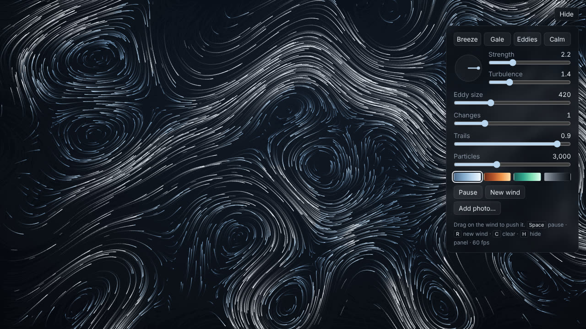
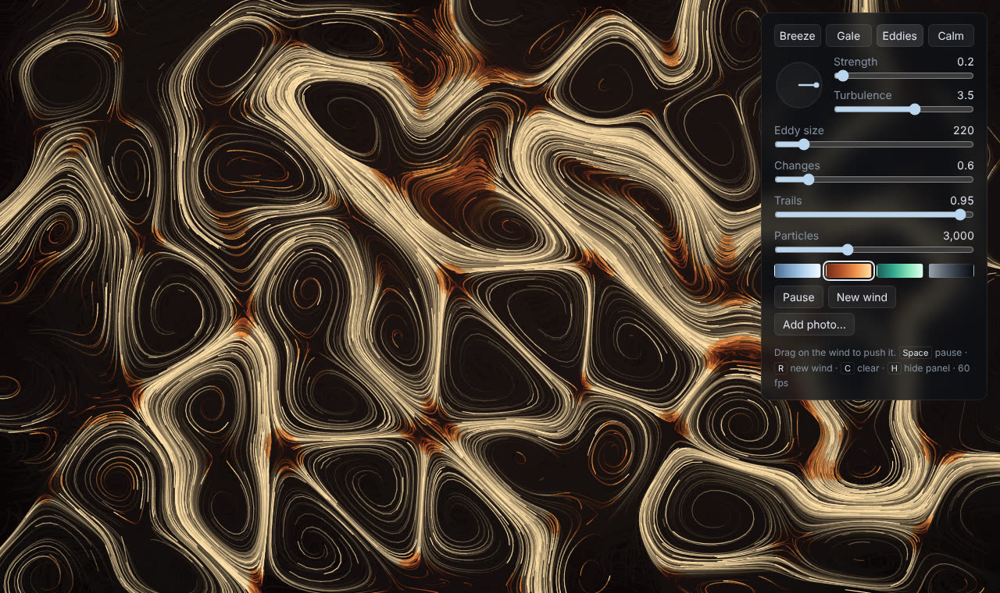
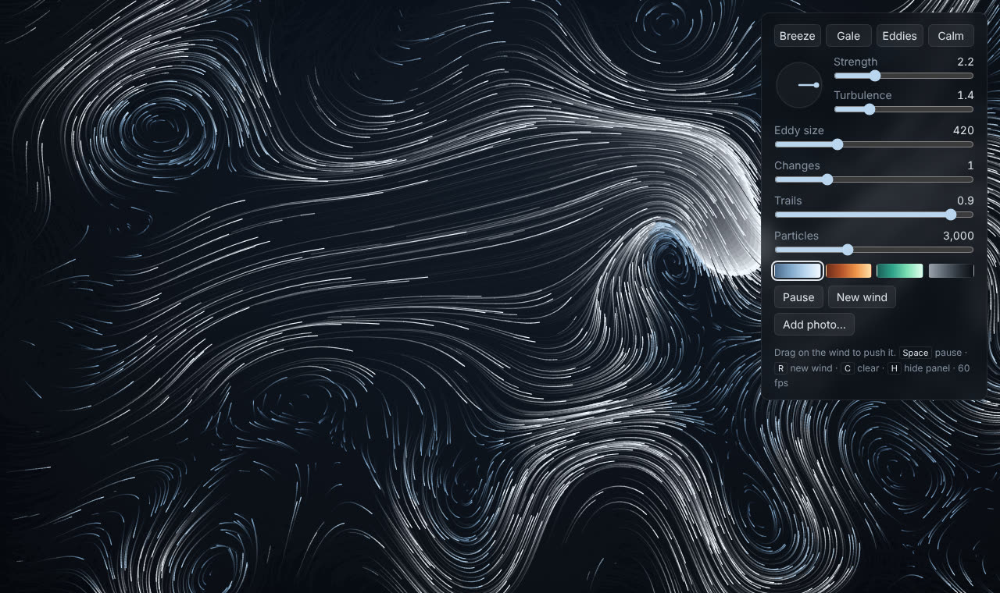

# gale

Wind animation in React. A few thousand particles following a flow field that keeps changing. You can drag across it to make a gust.

Live: https://samsonidze.github.io/gale/



This is a remake of my [wind-animation](https://github.com/samsonidze/wind-animation). The old one moved particles along sin/cos waves, and after a while you can see the pattern repeat. This one uses curl noise (the thing people use for smoke in games) so the wind swirls and doesn't repeat.



## Features

- drag anywhere to make a gust
- dial for wind direction
- sliders: strength, turbulence, eddy size, how fast it changes, trail length, particle count
- presets: Breeze, Gale, Eddies, Calm
- 4 colour themes
- you can add your own photo as background (button or drag it onto the page). It stays in your browser, nothing gets uploaded
- settings are saved in the URL so you can send someone a link to the same thing
- keys: Space = pause, R = new random wind, C = clear trails, H = hide panel
- slower and fewer particles if "reduce motion" is on in your OS



## How it works

Every frame each particle gets the wind at its position: the main wind (direction * strength) + a swirl part + any gusts nearby.

The swirl part is the curl of 3D simplex noise, x and y are the screen and z is time. I first tried the usual approach where the noise value is used as an angle, but particles kept collecting into thin lines and leaving empty areas. Taking the curl fixes that because the field has no divergence, so nothing piles up. There's a test for it.

Gusts are just extra velocity around the mouse that fades out (half-life 0.6s).

Trails: the canvas isn't cleared, it's faded a bit every frame with `destination-out`. That keeps it transparent so the background photo is still visible behind it.

Performance stuff:
- particle data is in Float32Arrays instead of an array of objects. With objects I was getting frame drops from garbage collection
- particles are grouped by colour and opacity and each group is drawn with one `stroke()`. One stroke per particle was way too slow
- settings are read from a ref inside the animation loop, so changing a slider doesn't restart it

60fps with 3000 particles on my laptop.

## Files

```
src/sim/noise.ts          simplex noise
src/sim/field.ts          wind at a point, curl, gusts
src/sim/particles.ts      particle system
src/settings.ts           defaults, presets, url hash
src/components/WindCanvas.tsx   animation loop + drawing
src/components/Controls.tsx     the panel
src/App.tsx
```

No libraries apart from React.

## Run

```
npm install
npm run dev
```

Tests: `npm test`

## Deploy

There's a GitHub Actions workflow for Pages. Go to Settings > Pages and set source to "GitHub Actions", then every push to main deploys.

Noise is based on Stefan Gustavson's simplex noise (public domain).
